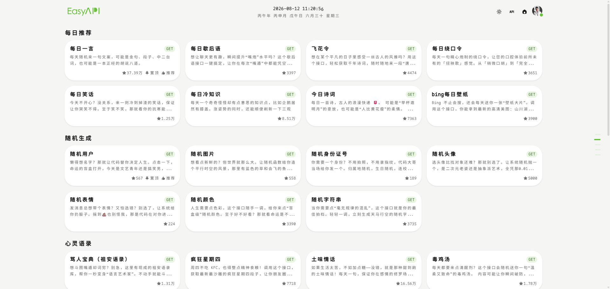
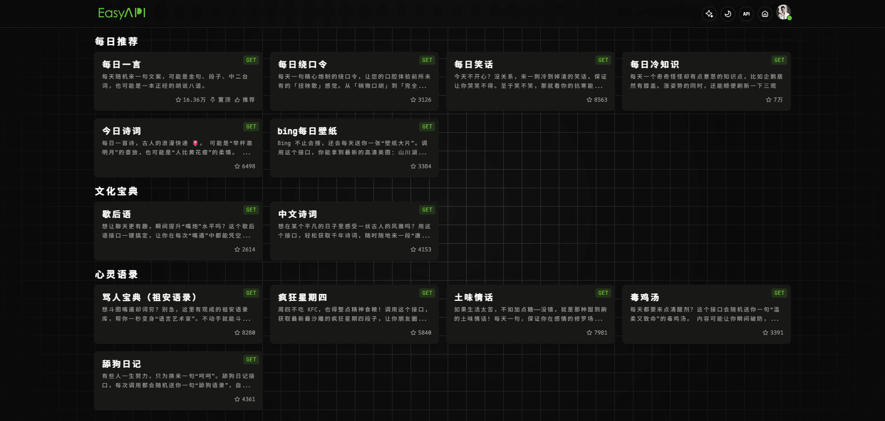
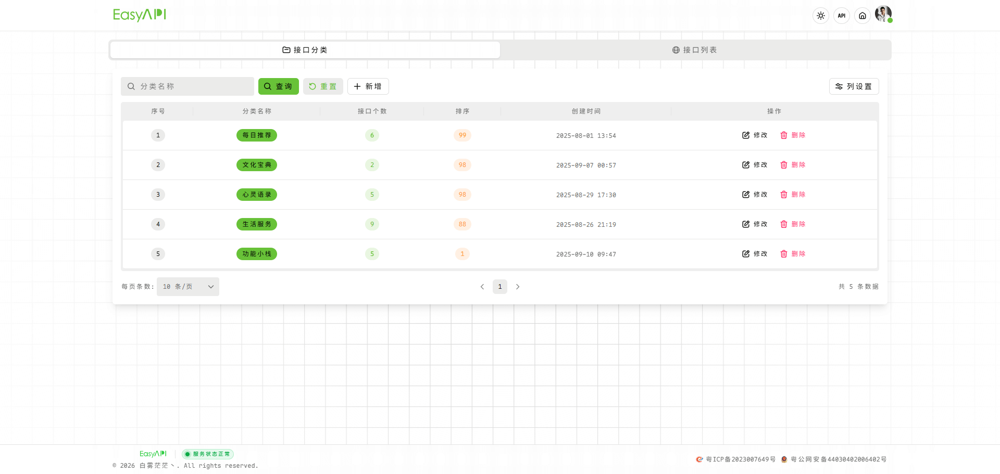
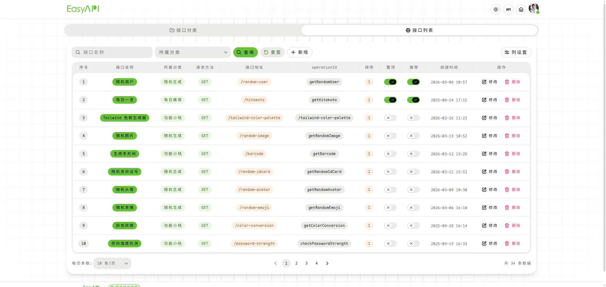

<div align="center">

<p>基于 Next.js 构建的高性能 API 聚合平台，统一管理多服务商接口，支持智能转发与数据缓存，让 API 集成更简单。</p>
</div>

<div align="center">
  <a href="https://vercel.com" target="_blank">
    
  </a>
  <a href="https://nextjs.org/" target="_blank">
    
  </a>
  <a href="https://www.heroui.com/" target="_blank">
    
  </a>
  <a href="https://supabase.com/" target="_blank">
    
  </a>
  <a href="https://tailwindcss.com/" target="_blank">
    
  </a>
  <a href="./LICENSE" target="_blank">
    
  </a>
</div>

## ☘️ 项目简介

一个把常用 `API` 收拾得干干净净的小站。

## 🌿 在线体验

➡️ [点击打开](https://api.baiwumm.com/)

## 🪴 技术栈

- **前端框架**: [Next 16.0](https://nextjs.org/) (基于 React19.x)
- **UI组件**: [Hero UI](https://www.heroui.com/)
- **样式方案**: [Tailwind CSS](https://www.tailwindcss.cn/)
- **后端服务**: [Supabase](https://supabase.com/) (开源Firebase替代品)
- **部署平台**: 支持 `Vercel` 等多种部署方式

## ✨ 特性
- 🚀 **高性能**: 基于最新前端技术栈，极速响应
- 🌓 **主题切换**: 完善的亮色/暗黑模式支持
- 🔍 **SEO友好**: 支持SSR渲染，优化搜索引擎收录
- 📱 **响应式设计**: 适配各种设备屏幕
- 🔒 **安全认证**: 基于Supabase的完整用户系统
- 🧩 **模块化架构**: 清晰的目录结构，便于二次开发

## 🪴 项目截图

| 亮色模式 | 暗色模式 |
|----------|----------|
|  |  |

| 接口分类 | 接口列表 |
|----------|----------|
|  |  |

## 🚀 快速开始

### 🌳 环境要求
- Node.js ≥ 18.17 (推荐最新LTS版本)
- pnpm (推荐) 或 npm/yarn

### ⚙️ 环境变量

在项目根目录创建 `.env`，示例：

```bash
NEXT_PUBLIC_SUPABASE_URL="xxx"
NEXT_PUBLIC_SUPABASE_ANON_KEY="xxx"

# 项目名称
NEXT_PUBLIC_APP_NAME = 'Easy Api'
# 项目描述
NEXT_PUBLIC_APP_DESC = '基于 Next.js 构建的高性能 API 聚合平台，统一管理多服务商接口，支持智能转发与数据缓存，让 API 集成更简单。'
# 项目关键词
NEXT_PUBLIC_APP_KEYWORDS = 'Easy Api,API聚合,API管理,接口聚合平台,Next.js API,Next.js聚合,API网关,微服务网关,接口代理,请求转发,数据缓存,RESTful API,第三方API集成,Serverless,Next.js 16,TypeScript,API路由,后端即服务,BaaS,低代码平台,开发工具'
# 项目域名
NEXT_PUBLIC_APP_URL = 'http://localhost:5173'
# 版权
NEXT_PUBLIC_COPYRIGHT = '白雾茫茫丶'
# 网站ICP
NEXT_PUBLIC_ICP = '粤ICP备2023007649号'
# 网站公网备案
NEXT_PUBLIC_GUAN_ICP = '粤公网安备44030402006402号'
# Umami ID
NEXT_PUBLIC_UMAMI_ID = 'ad3191c9-9087-489d-b171-f1d7f7be6a48'
# Google ID
NEXT_PUBLIC_GOOGLE_ID = 'G-0EBBC636CZ'
# Clarity ID
NEXT_PUBLIC_CLARITY_ID = 'sd60to8yr0'
```

### 🧑‍💻 本地开发
```bash
# 克隆项目
git clone https://github.com/baiwumm/EasyAPI.git

# 进入项目目录
cd EasyAPI

# 安装依赖
pnpm install

# 启动开发服务器
pnpm dev
```

### 📝 接口分类
```
🍀 每日推荐
   - 每日一言
   - 每日绕口令
   - 每日笑话
   - 每日冷知识
   - 今日诗词
   - bing 每日壁纸
🐼 文化宝典
   - 歇后语
   - 中文诗词
🌴 心灵语录
   - 骂人宝典（祖安语录）
   - 疯狂星期四
   - 土味情话
   - 毒鸡汤
   - 舔狗日记
🌱 生活服务
   - 二十四节气
   - BMI 计算器
   - 十二时辰黄历
   - 法定节假日
   - 国际区号查询
   - 车牌归属地查询
   - 邮政编码查询
   - IP 归属地查询
   - 身份证信息查询
🛠️ 功能小栈
   - 随机用户
   - 颜色转换
   - 密码强度检测
   - 生成二维码
   - 随机颜色
   - 随机字符串
   - 随机表情
```


## ⚙️ Vercel 一键部署
1. `Fork` 本项目，在 `Vercel` 官网点击 `New Project`
2. 点击 `Import Git Repository` 并选择你 fork 的此项目并点击 `import`
3. `PROJECT NAME`自己填，`FRAMEWORK PRESET` 选 `Other` 然后直接点 `Deploy` 接着等部署完成即可

<a href="https://vercel.com/dashboard" target="_blank">

</a>

## 📜 许可证
本项目采用 [MIT](LICENSE) 许可证。

## ⭐ Star History

[](https://star-history.com/#baiwumm/EasyAPI&Date)